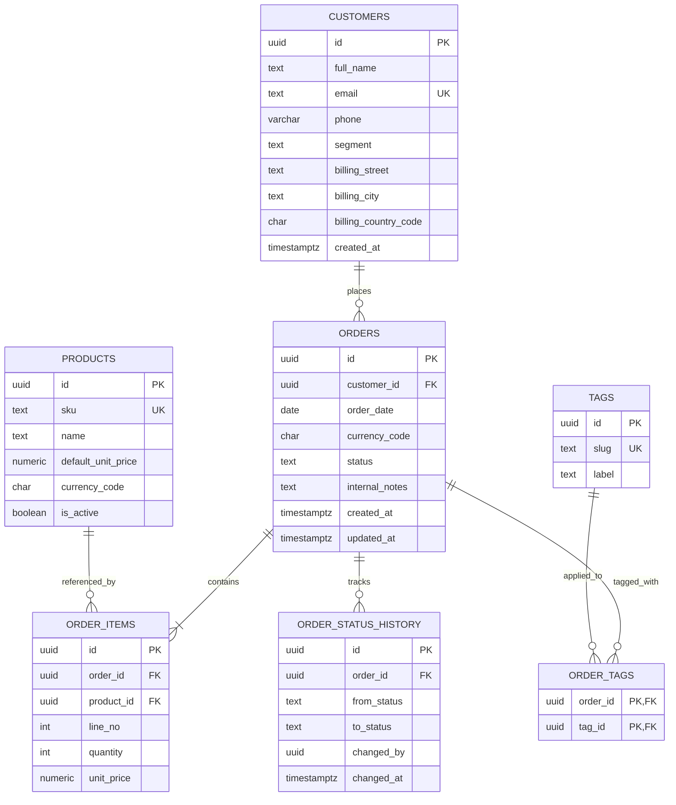

# Worked Example: Figma Forms to 3NF Schema & ERD

## Scenario: Extracted Figma Frames

Suppose Figma contains three connected frames:
1. **`Frame 1: Customer Intake Modal`**
   - `Full Name *` (Text)
   - `Email *` (Email)
   - `Phone` (Phone)
   - `Segment` (Single-select: `Retail`, `Wholesale`, `VIP`)
   - `Billing Address` (Street, City, Country)
2. **`Frame 2: Create Order Form`**
   - `Customer *` (Searchable dropdown -> Frame 1)
   - `Order Date *` (Date)
   - `Currency *` (Dropdown: `USD`, `EUR`, `SAR`)
   - `Tags` (Multi-select chips: `Urgent`, `Gift`, `Fragile`, `Wholesale`)
   - `Order Line Items *` (Repeatable subform: `Product *`, `Qty *`, `Unit Price *`, `Line Total` [read-only])
   - `Order Total` (Read-only summary)
   - `Internal Notes` (Textarea)
3. **`Frame 3: Order Detail & Status Bar`**
   - `Status` (Badge: `Draft`, `Submitted`, `Paid`, `Shipped`, `Cancelled`)
   - `Status Timeline` (List of status changes with timestamp & actor)

---

## Step-by-Step Normalization

- **1NF:**
  - `Order Line Items` is a repeating group -> extract to `order_items` (`1:N` from `orders`).
  - `Tags` is a multi-select chip list -> extract `tags` + `order_tags` junction table (`M:N`).
  - Split `Billing Address` into atomic columns (`billing_street`, `billing_city`, `billing_country_code`).
- **2NF:**
  - In `order_items`, `product_name` and `sku` depend only on `product_id`, not `(order_id, line_no)` -> keep catalog attributes in `products`; store `unit_price` snapshot on `order_items` so historical orders do not mutate when catalog prices change.
- **3NF / BCNF:**
  - `Customer` attributes (`full_name`, `email`, `phone`, `segment`) depend on `customer_id`, not `order_id` -> separate `customers` table.
  - Drop computed `Line Total` and `Order Total` from base tables (compute via `qty * unit_price` or query/view).
  - Extract `Status Timeline` into `order_status_history` (`1:N` from `orders`).

---

## Output 1: Mermaid `erDiagram`



---

## Output 2: UI-to-Schema Traceability Matrix

| Figma Frame | UI Field / Widget | Target `table.column` | Transformation / Rule |
| :--- | :--- | :--- | :--- |
| Customer Intake | `Full Name *` | `customers.full_name` | `TEXT NOT NULL`, non-empty check |
| Customer Intake | `Email *` | `customers.email` | `CITEXT NOT NULL UNIQUE` |
| Customer Intake | `Segment` | `customers.segment` | `CHECK (segment IN ('retail','wholesale','vip'))` |
| Customer Intake | `Billing Address` | `customers.billing_{street,city,country_code}` | Atomic 1NF columns; ISO-3166 `CHAR(2)` |
| Create Order | `Customer *` | `orders.customer_id` | `UUID NOT NULL REFERENCES customers(id) ON DELETE RESTRICT` |
| Create Order | `Order Date *` | `orders.order_date` | `DATE NOT NULL` |
| Create Order | `Currency *` | `orders.currency_code` | `CHAR(3) NOT NULL` |
| Create Order | `Tags` (multi-select) | `order_tags.(order_id, tag_id)` | M:N junction to `tags` |
| Create Order | `Order Line Items *` | `order_items.(order_id, product_id, line_no, quantity, unit_price)` | 1NF child table; `quantity > 0`, `unit_price >= 0` |
| Create Order | `Line Total` / `Order Total` | *(derived, not stored)* | Computed as `SUM(quantity * unit_price)` |
| Order Detail | `Status` | `orders.status` | `CHECK (status IN ('draft','submitted','paid','shipped','cancelled'))` |
| Order Detail | `Status Timeline` | `order_status_history` | Append-only audit trail per transition |

---

## Output 3: PostgreSQL DDL

```sql
CREATE TABLE customers (
    id UUID PRIMARY KEY DEFAULT gen_random_uuid(),
    full_name TEXT NOT NULL CHECK (length(trim(full_name)) > 0),
    email TEXT NOT NULL UNIQUE,
    phone VARCHAR(20),
    segment TEXT NOT NULL DEFAULT 'retail' CHECK (segment IN ('retail', 'wholesale', 'vip')),
    billing_street TEXT,
    billing_city TEXT,
    billing_country_code CHAR(2),
    created_at TIMESTAMPTZ NOT NULL DEFAULT now()
);

CREATE TABLE products (
    id UUID PRIMARY KEY DEFAULT gen_random_uuid(),
    sku TEXT NOT NULL UNIQUE,
    name TEXT NOT NULL,
    default_unit_price NUMERIC(12,2) NOT NULL CHECK (default_unit_price >= 0),
    currency_code CHAR(3) NOT NULL DEFAULT 'USD',
    is_active BOOLEAN NOT NULL DEFAULT true
);

CREATE TABLE orders (
    id UUID PRIMARY KEY DEFAULT gen_random_uuid(),
    customer_id UUID NOT NULL REFERENCES customers(id) ON DELETE RESTRICT,
    order_date DATE NOT NULL DEFAULT CURRENT_DATE,
    currency_code CHAR(3) NOT NULL DEFAULT 'USD',
    status TEXT NOT NULL DEFAULT 'draft' CHECK (status IN ('draft', 'submitted', 'paid', 'shipped', 'cancelled')),
    internal_notes TEXT,
    created_at TIMESTAMPTZ NOT NULL DEFAULT now(),
    updated_at TIMESTAMPTZ NOT NULL DEFAULT now()
);

CREATE INDEX idx_orders_customer_id ON orders(customer_id);
CREATE INDEX idx_orders_status ON orders(status);

CREATE TABLE order_items (
    id UUID PRIMARY KEY DEFAULT gen_random_uuid(),
    order_id UUID NOT NULL REFERENCES orders(id) ON DELETE CASCADE,
    product_id UUID NOT NULL REFERENCES products(id) ON DELETE RESTRICT,
    line_no INTEGER NOT NULL CHECK (line_no > 0),
    quantity INTEGER NOT NULL CHECK (quantity > 0),
    unit_price NUMERIC(12,2) NOT NULL CHECK (unit_price >= 0),
    UNIQUE (order_id, line_no)
);

CREATE INDEX idx_order_items_product_id ON order_items(product_id);

CREATE TABLE tags (
    id UUID PRIMARY KEY DEFAULT gen_random_uuid(),
    slug TEXT NOT NULL UNIQUE,
    label TEXT NOT NULL
);

CREATE TABLE order_tags (
    order_id UUID NOT NULL REFERENCES orders(id) ON DELETE CASCADE,
    tag_id UUID NOT NULL REFERENCES tags(id) ON DELETE CASCADE,
    PRIMARY KEY (order_id, tag_id)
);

CREATE INDEX idx_order_tags_tag_id ON order_tags(tag_id);

CREATE TABLE order_status_history (
    id UUID PRIMARY KEY DEFAULT gen_random_uuid(),
    order_id UUID NOT NULL REFERENCES orders(id) ON DELETE CASCADE,
    from_status TEXT,
    to_status TEXT NOT NULL,
    changed_by UUID,
    changed_at TIMESTAMPTZ NOT NULL DEFAULT now()
);

CREATE INDEX idx_order_status_history_order_id ON order_status_history(order_id);
```
