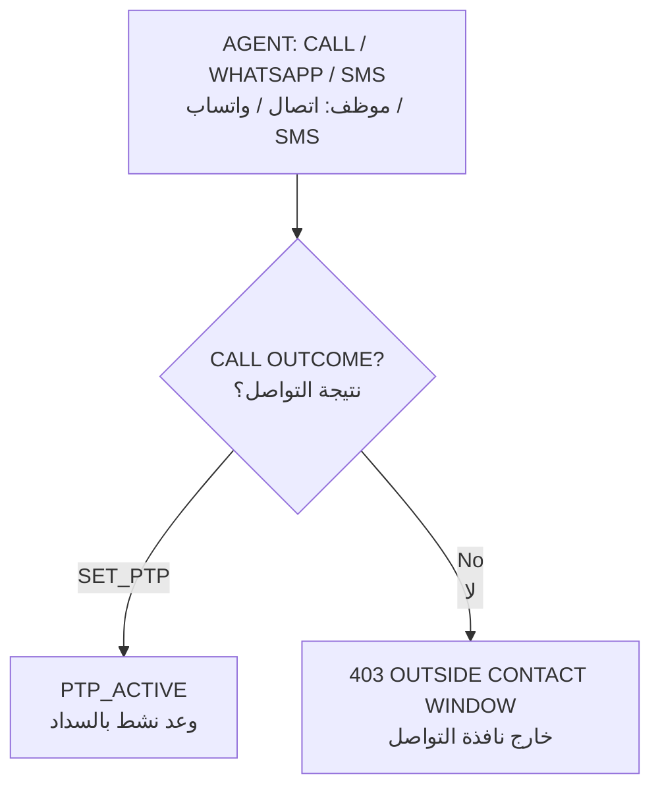

# Mermaid + HUD reference

## Label quoting



Bad: `dial[موظف: اتصال / واتساب / SMS]` (unquoted `/` breaks parse).
Bad: `id call` or `id end`.
Bad: `<b>` / `<br/>` in `.mmd` — clips first Latin letters under RTL. Use `"EN\nAR"`.

## Init (injected — do not paste into shared `.mmd`)

- Teal gallery: `docs/graphs/theme.json`
- Noir present: `docs/graphs/theme-noir.json` — background `#0B0C10`, text `#F8FAFC`, unclassified border `#38BDF8`, line `#94A3B8`
- Font: Inter + IBM Plex Sans Arabic; codes in Roboto Mono
- `flowchart.curve: basis`, `nodeSpacing: 42`, `rankSpacing: 58` (noir)

## class names in `.mmd` (colors injected for all 18)

Put `class id hudCore` etc. in the source. Exporter appends `TEAL_CLASSDEF` / `NOIR_CLASSDEF` (plus aliases `highlight`/`process`/`decision`/`terminal`/`block`). Do not put hex `classDef` in `.mmd`. Do not use `classifyHud` regex.

```
classDef hudCore     fill:#111827,stroke:#22D3EE,stroke-width:2.5px,color:#E6EDF3,rx:8,ry:8
classDef hudActive   fill:#0B1C1F,stroke:#22D3EE,stroke-width:2.5px,color:#E0F2FE,rx:8,ry:8
classDef hudPending  fill:#1A1408,stroke:#F59E0B,stroke-width:2.5px,color:#FDE68A,rx:8,ry:8
classDef hudBlock    fill:#1A0A0E,stroke:#E11D48,stroke-width:2.5px,color:#FECACA,rx:8,ry:8
classDef hudGate     fill:#111827,stroke:#94A3B8,stroke-width:2px,color:#E6EDF3
classDef hudFlag     fill:#161B22,stroke:#8B949E,stroke-width:2px,color:#CBD5E1,rx:8,ry:8
classDef hudEntry    fill:#161B22,stroke:#CBD5E1,stroke-width:2px,color:#E6EDF3,rx:8,ry:8
```

## Export

```powershell
npm run export:graphs                 # teal gallery + export/*.svg|png
npm run export:graphs:present         # noir 16:9 present/index.html + present/export/*.png
node docs/graphs/export-graphs.mjs --present --html-only
```
